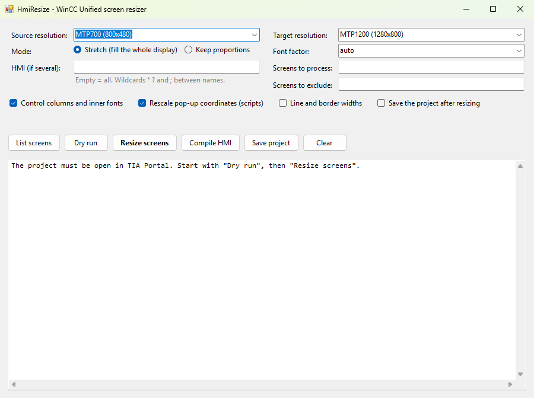

# HmiResize — adapter les vues WinCC Unified à un nouvel écran (TIA Portal Openness)

🇬🇧 [English version](README.md)

**HmiResize** adapte automatiquement toutes les vues d'un IHM **SIMATIC WinCC Unified**
(Unified Basic Panel, Unified Comfort Panel, PC Runtime) à une nouvelle résolution d'écran,
directement dans le projet ouvert dans **TIA Portal**, grâce à l'API **TIA Portal Openness**.

Cas typique : un pupitre **MTP700 (800x480)** remplacé par un **MTP1200 (1280x800)**. Après
le changement d'appareil dans TIA Portal, les vues gardent leur ancienne taille et le
nouvel écran n'est pas rempli. Au lieu de redimensionner des centaines d'objets à la main,
HmiResize met à l'échelle les vues, les objets, les polices, les colonnes des contrôles et
même les coordonnées des pop-ups dans les scripts, en une seule opération annulable.



## Fonctionnalités

- Se connecte au **TIA Portal déjà ouvert** (aucun export/import XML).
- Résolutions par nom de pupitre (`MTP400`, `MTP700`, `MTP1000`, `MTP1200`, `MTP1500`,
  `MTP1900`, `MTP2200`) ou en pixels (`1024x600`).
- Mode **étirer** (remplit tout l'écran) ou **proportions gardées**.
- **Une seule transaction** : un seul Ctrl+Z dans TIA Portal annule tout.
- Mode **simulation** (`--dry-run`) pour voir ce qui serait modifié.
- Rapport de ce qu'il faut vérifier à la main.
- Compilation de l'IHM et enregistrement du projet depuis l'outil.
- **Interface graphique** simple (`HmiResizeGui.exe`) ou **ligne de commande** (`HmiResize.exe`).

## Prérequis

- Windows, **TIA Portal V21** avec WinCC Unified (le code peut être recompilé pour une
  autre version, voir plus bas).
- L'utilisateur Windows doit être membre du groupe **Siemens TIA Openness**
  (PowerShell **administrateur**) :
  ```
  net localgroup "Siemens TIA Openness" "%USERNAME%" /add
  ```
  puis **fermer la session Windows et la rouvrir**.
- Aucun SDK à installer : le compilateur C# fourni avec Windows (.NET Framework 4.8) suffit.

## Compilation

Double-cliquer sur `build.bat` (ou `build.bat 21` pour TIA Portal V21). Cela produit :

- `HmiResize.exe` : le moteur, en ligne de commande ;
- `HmiResizeGui.exe` : l'interface graphique, qui a besoin de `HmiResize.exe` dans le même dossier.

Les DLL Openness ne sont pas copiées : elles sont chargées depuis l'installation de TIA
Portal (chemin lu dans le registre Siemens).

## Utilisation

Le projet doit être ouvert dans TIA Portal. Au premier lancement, TIA demande
d'autoriser l'accès Openness : répondre **Oui à tout**.

### Avec l'interface graphique

1. Lancer `HmiResizeGui.exe`.
2. Choisir la résolution d'origine et la résolution cible.
3. **Dry run** (simulation) : affiche ce qui serait modifié, sans rien changer.
4. **Resize screens** : fait l'adaptation (une confirmation est demandée).
5. Vérifier dans TIA, puis **Compile HMI** (compiler) et **Save project** (enregistrer).

L'interface et les messages du programme sont en anglais.

Chaque bouton lance `HmiResize.exe` avec les options choisies ; le rapport s'affiche en
direct et la commande lancée est rappelée, ce qui permet de la réutiliser en ligne de commande.

### En ligne de commande

```
HmiResize.exe --list                                 liste les IHM et la taille des vues
HmiResize.exe --from MTP700 --to MTP1200 --dry-run   simulation, ne modifie rien
HmiResize.exe --from MTP700 --to MTP1200             adaptation réelle
HmiResize.exe --compile                              compile l'IHM et affiche les erreurs
HmiResize.exe --save-only                            enregistre le projet
```

| Option | Rôle |
|---|---|
| `--to <rés.>` | Résolution cible (obligatoire) : `1280x800` ou un nom de pupitre |
| `--from <rés.>` | Résolution d'origine. Par défaut `auto` = taille de vue la plus fréquente. **À préciser** si TIA a déjà agrandi les vues lors du changement de pupitre |
| `--mode stretch` | Étire X et Y séparément pour remplir tout l'écran (défaut) |
| `--mode uniform` | Même facteur en X et Y : les proportions sont gardées, mais il peut rester une bande vide |
| `--font auto` / `none` / `1.5` | Polices × min(facteur X, facteur Y) (défaut), polices inchangées, ou facteur imposé |
| `--lines` | Met aussi à l'échelle les épaisseurs de traits et de bordures |
| `--no-parts` | Ne touche pas aux sous-éléments des contrôles (colonnes, barres d'outils, polices internes) |
| `--no-scripts` | Ne modifie pas les coordonnées écrites en chiffres dans les `OpenScreenInPopup` |
| `--device <nom>` | IHM à traiter si le projet en contient plusieurs |
| `--screens "Vue1;Synoptique*"` | Ne traite que certaines vues (joker `*` `?`) |
| `--exclude "Popup*"` | Vues à ne pas traiter |
| `--save` | Enregistre le projet à la fin |
| `--log rapport.txt` | Écrit aussi le rapport dans un fichier |
| `--pid <n>` | Choix du TIA Portal si plusieurs sont ouverts |
| `--compile` | Compile le logiciel IHM et affiche erreurs / avertissements, puis quitte |
| `--save-only` | Enregistre le projet ouvert, puis quitte |
| `--dump "Vue1;Vue2"` | Diagnostic : affiche tous les objets, propriétés et scripts de ces vues |

## Ce qui est adapté

- **Vues** : les vues plein écran passent à la taille cible. Une vue affichée dans une
  fenêtre de vue (bandeau, zone de contenu chargée par `ChangeScreen`) prend exactement la
  nouvelle taille de cette fenêtre, au pixel près. Les autres vues plus petites (pop-ups)
  sont agrandies dans les mêmes proportions.
- **Objets à cadre** (boutons, champs E/S, textes, rectangles, contrôles, fenêtres de vue,
  conteneurs de faceplate…) : position et taille. Ce sont les bords qui sont mis à
  l'échelle, pour que deux objets côte à côte restent collés malgré les arrondis.
- **Lignes** : les deux extrémités. **Polylignes et polygones** : l'origine et tous les points.
- **Cercles, ellipses, arcs, segments** : centre et rayons.
- **Polices** (`Font.Size`) et **marges internes** (`Padding`).
- **Sous-éléments des contrôles** : largeur des colonnes (alarmes, tableaux…), hauteur
  des lignes, éléments des barres d'outils et polices internes.
- **Scripts** : dans les appels `OpenScreenInPopup(..., left, top, ...)`, les coordonnées
  écrites en chiffres sont mises à l'échelle (`50, 50` → `80, 83`) et la ligne est marquée
  `/*HmiResize*/`. Les coordonnées passées par variable sont signalées dans le rapport.

## À vérifier à la main (signalé dans le rapport)

- Les propriétés de position ou de taille **dynamisées** (tag ou script).
- Le **contenu des faceplates** (types de bibliothèque) : seul leur conteneur est adapté.
- Les **scripts** qui déplacent ou dimensionnent des objets (`.Left`, `.Top`, `.Width`,
  `.Height`, ou `OpenScreenInPopup` avec des coordonnées en variable).
- Les **images** (vues graphiques) étirées.
- Le **contrôle de diagnostic système** : seul le cadre est adapté, car la lecture de
  certains de ses sous-éléments fait planter TIA Portal V21.
- Les **polylignes / polygones** : pas encore testés sur un projet réel.

⚠️ Relancer le programme sur des vues déjà adaptées les agrandit encore une fois.
En cas de doute, faire d'abord une simulation. Travaillez toujours sur une copie du projet.

## Essai réalisé

TIA Portal V21, IHM WinCC Unified Basic, MTP700 → MTP1200 : 34 vues, 655 objets,
34 appels de pop-up recalés, aucune erreur ; la compilation de l'IHM donne 0 erreur et
0 avertissement.

## Autre version de TIA Portal

`build.bat 20` compile contre TIA Portal V20, etc. L'API WinCC Unified évolue d'une
version à l'autre : des ajustements du code peuvent être nécessaires.

## Fichiers

- `src/HmiResize.cs` : le moteur (C# 5 / .NET Framework 4.8)
- `src/HmiResizeGui.cs` : l'interface graphique (Windows Forms)
- `build.bat` : compile les deux programmes

## Avertissement

Projet indépendant, sans lien avec Siemens AG. SIMATIC, WinCC et TIA Portal sont des
marques de Siemens AG. Utilisation à vos risques : faites une sauvegarde de votre projet
avant toute modification.

## Licence

[MIT](LICENSE)
